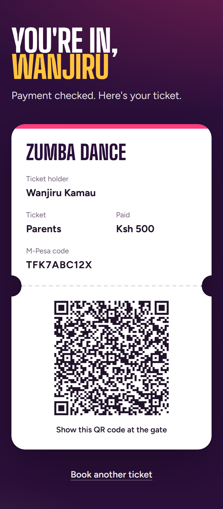
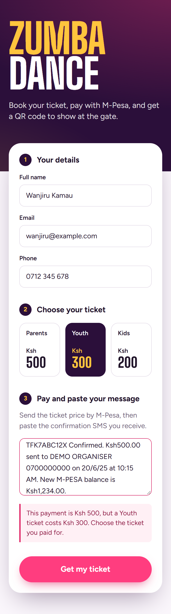
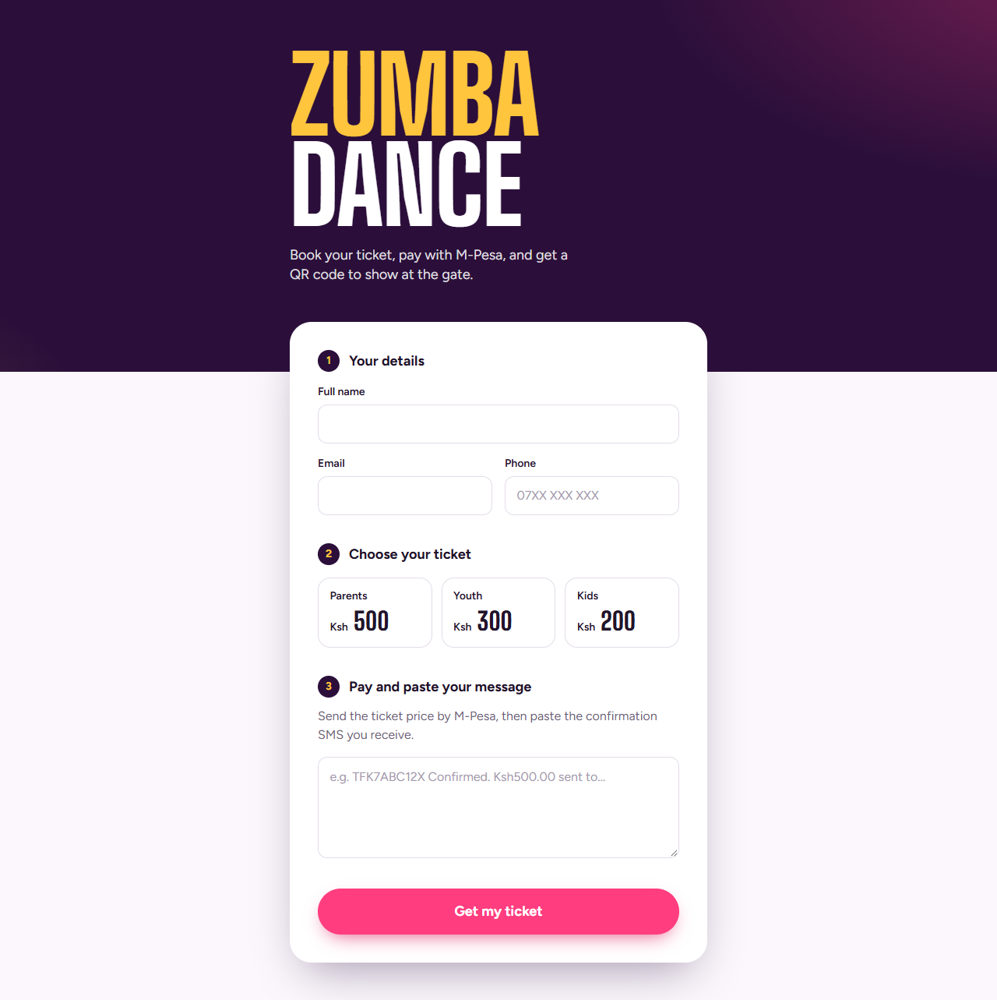

# Zumba Ticketing

A web app for selling tickets to a community Zumba dance event in Kenya. Attendees pay
by **M-Pesa**, paste the confirmation SMS into the booking form, and the app checks the
amount and the recipient before issuing a **QR-code ticket** to show at the gate.

No payment gateway, merchant account or API keys are needed: the app works with the
confirmation message people already receive.

> **Status:** unfinished prototype. It was built for a real community event in June
> 2025 but wasn't finished in time to be used there. The front end works end to end;
> there's no back end yet (see [Limitations](#limitations) and [Roadmap](#roadmap)).

<p>
  
  &nbsp;
  
</p>

## How it works

1. **Your details:** the attendee enters their name, email and phone number.
2. **Choose your ticket:**

   | Ticket | Price |
   |---|---|
   | Parents | Ksh 500 |
   | Youth | Ksh 300 |
   | Kids | Ksh 200 |

3. **Pay and paste:** they send the ticket price by M-Pesa, then paste the confirmation
   SMS.
4. The app reads the message:
   - **amount:** `/Ksh\s?(\d+(\.\d+)?)/i` must equal the price of the chosen ticket;
   - **recipient:** the name after "sent to" / "paid to" must match the organiser's
     registered M-Pesa name.
5. If a check fails, an inline error explains what to fix. Otherwise the attendee gets a
   **ticket** showing their name, ticket type, amount paid, the M-Pesa transaction code
   and a QR code.



## Tech stack

| Area | Technology |
|---|---|
| UI | React 18 |
| Routing | React Router 7 |
| Build tool | Vite 6 |
| Styling | Tailwind CSS 4 (`@theme` design tokens), Big Shoulders Display and Figtree fonts |
| QR codes | qrcode.react |
| Type checking | TypeScript (`tsc --noEmit`) |

## Getting started

Requires Node.js 20 or later.

```bash
npm install
npm run dev
```

Open http://localhost:5173.

### Try it with a sample message

Choose **Parents** and paste:

```
TFK7ABC12X Confirmed. Ksh500.00 sent to DEMO ORGANISER 0700000000 on 20/6/25 at 10:15 AM. New M-PESA balance is Ksh1,234.00.
```

Use `Ksh300.00` for Youth or `Ksh200.00` for Kids. Choose a different ticket, or change
the name after "sent to", to see the error messages.

### Set the organiser's name

The app accepts payments sent to `DEMO ORGANISER` by default. To use it for a real
event, copy `.env.example` to `.env` and set the organiser's M-Pesa name as it appears
in the SMS:

```bash
VITE_PAYEE_NAME=ORGANISER FULL NAME
```

`.env` is git-ignored, so the real name stays out of the repository.

### Build for production

```bash
npm run build     # type check, then build to dist/
npm run preview   # serve the production build locally
```

`dist/` is a static site and can be hosted on Vercel, Netlify or any static host.

## Project structure

```
index.html            page shell, fonts
src/
  main.jsx            React root and router
  App.jsx             routes: / and /success
  tickets.js          ticket prices, M-Pesa message checks, transaction-code parsing
  index.css           Tailwind setup, design tokens and components (tiles, ticket)
  pages/
    Home.jsx          booking form
    Success.jsx       ticket with QR code
docs/screenshots/     images used in this README
```

## Limitations

This is a front-end prototype, so the checks prove that a message *looks* right, not
that a payment happened:

- Validation runs in the browser, so a typed-up fake message passes.
- The M-Pesa transaction code isn't checked for reuse, so one message can produce many
  tickets.
- Nothing is stored: there's no attendee list and no way to scan tickets at the gate.
- The QR code holds the booking as plain, unsigned JSON (including contact details).
- The `Dockerfile` comes from the original React Router template and is out of date;
  it doesn't work with the current static build.

## Roadmap

1. Deploy the front end.
2. Add a back end (the Vite dev server already proxies `/api` to port 3001) with a
   database of bookings.
3. Verify payments on the server: reject reused transaction codes, and ideally confirm
   payments through the Safaricom Daraja API (C2B or STK Push) instead of pasted text.
4. Put only a signed ticket ID in the QR code, never personal data.
5. Add a gate-scanner page for organisers and an admin view with an attendee list and
   CSV export.
6. Email tickets to attendees.
7. Unit tests for the message checks (valid, wrong amount, wrong recipient, reused
   code).
